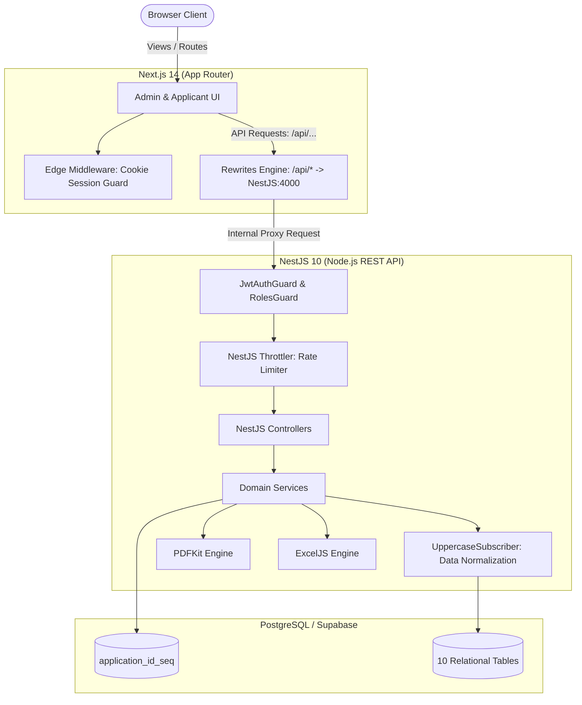
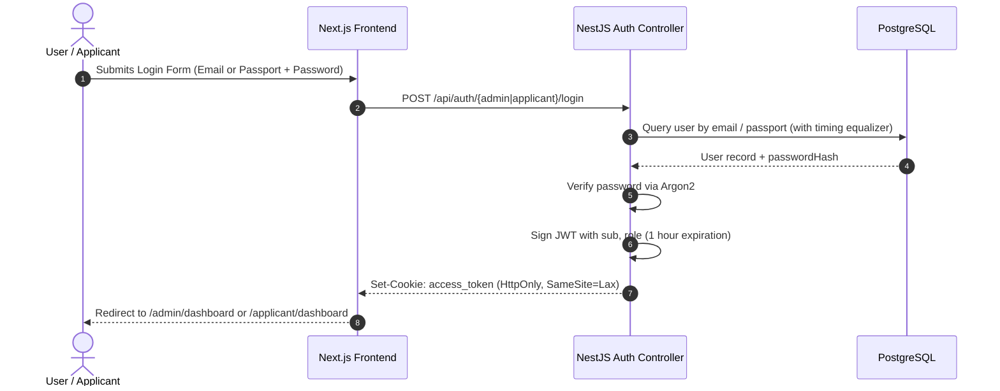
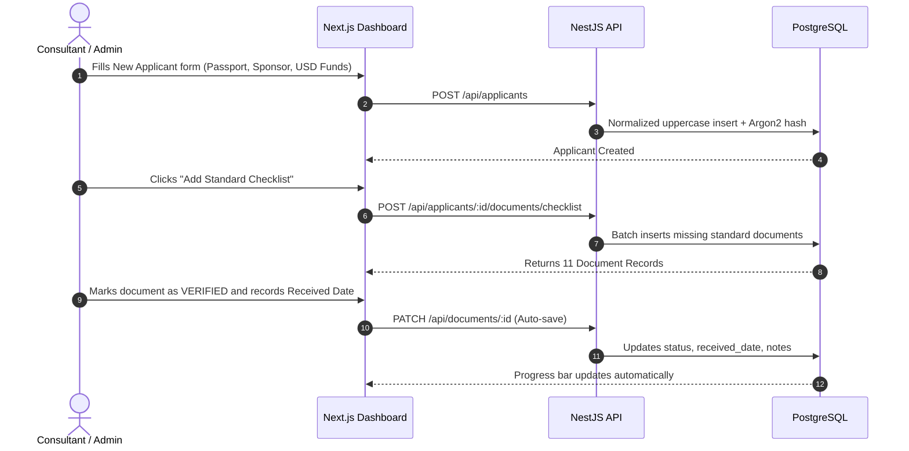
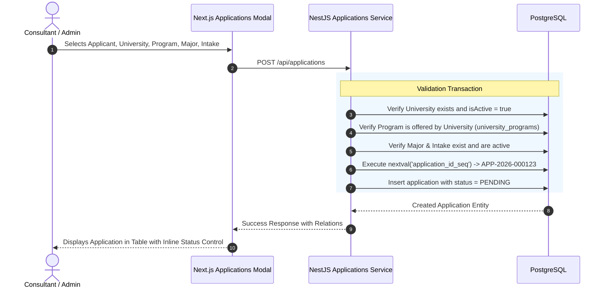
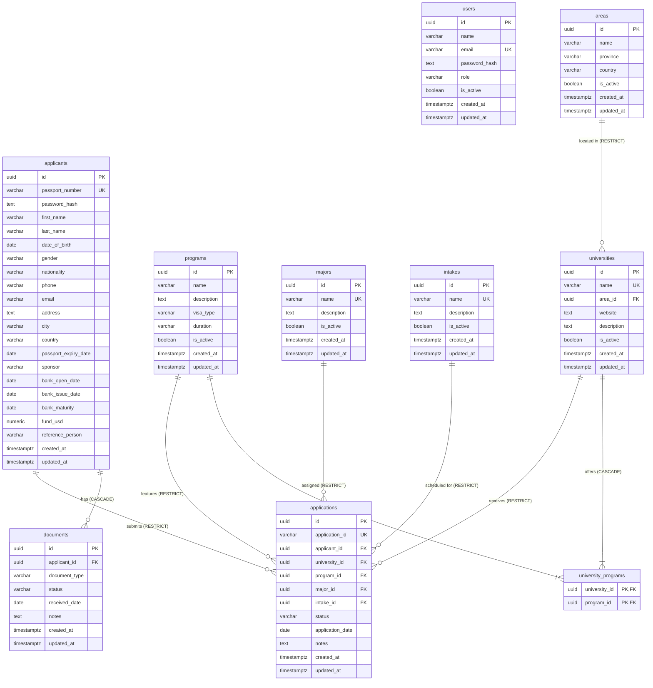

# Alvix Education Consultancy Portal

An enterprise-grade, full-stack visa and university application management platform built for overseas education agencies, educational consultancies, and international student advisory teams. 

The system streamlines the entire student placement lifecycle—from candidate onboarding and financial sponsor auditing to degree selection, document verification checklists, university application tracking, and automated PDF dossier printing.

---

## Table of Contents

- [Overview](#overview)
- [System Architecture](#system-architecture)
- [Tech Stack](#tech-stack)
- [Key Features](#key-features)
  - [Role-Based Access Control (RBAC)](#role-based-access-control-rbac)
  - [Applicant Lifecycle & Financial Auditing](#applicant-lifecycle--financial-auditing)
  - [Document Checklist & Compliance Engine](#document-checklist--compliance-engine)
  - [Application Management & Sequence Pipeline](#application-management--sequence-pipeline)
  - [Academic Master Data Management](#academic-master-data-management)
  - [Analytics & Real-Time Operational Dashboard](#analytics--real-time-operational-dashboard)
  - [Reporting, Excel Export & Vector PDF Generation](#reporting-excel-export--vector-pdf-generation)
  - [Security & Data Normalization](#security--data-normalization)
- [Operational Workflows](#operational-workflows)
  - [1. Authentication & Session Flow](#1-authentication--session-flow)
  - [2. Student Onboarding & Document Verification Flow](#2-student-onboarding--document-verification-flow)
  - [3. Application Submission & Validation Cascade](#3-application-submission--validation-cascade)
- [Complete API Reference](#complete-api-reference)
  - [Authentication API (`/api/auth`)](#authentication-api-apiauth)
  - [Dashboard & Analytics API (`/api/dashboard`)](#dashboard--analytics-api-apidashboard)
  - [Applicant Management API (`/api/applicants`)](#applicant-management-api-apiapplicants)
  - [Document Checklist API (`/api/documents`)](#document-checklist-api-apidocuments)
  - [Application Tracking API (`/api/applications`)](#application-tracking-api-apiapplications)
  - [Reports & PDF Export API (`/api/reports`)](#reports--pdf-export-api-apireports)
  - [Academic Master Data APIs](#academic-master-data-apis)
  - [Staff User Administration API (`/api/users`)](#staff-user-administration-api-apiusers)
- [Database Schema & Data Model](#database-schema--data-model)
- [Local Development & Setup](#local-development--setup)
  - [Prerequisites](#prerequisites)
  - [Backend Setup](#backend-setup)
  - [Frontend Setup](#frontend-setup)
  - [Default Credentials](#default-credentials)
- [Environment Variables](#environment-variables)
- [Security Guidelines & Production Deployment](#security-guidelines--production-deployment)

---

## Overview

The **Alvix Education Consultancy Portal** solves the operational friction that education consultancies encounter when processing hundreds of student visa applications simultaneously. Managing multiple target countries, university degree catalogs, bank solvency requirements, and strict embassy document guidelines demands tight record-keeping and data integrity.

### Target Personas & Portals

1. **Staff & Administrative Portal (`/admin/*`)**:
   - **Super Administrators**: Complete control over agency staff accounts, master data, record deletions, and system configuration.
   - **Education Consultants / Counselors**: Real-time management of applicants, document checklists, application filings, Excel exports, and PDF generation.
2. **Applicant Self-Service Portal (`/applicant/*`)**:
   - **International Students / Applicants**: Log in with their passport number and assigned password to track document verification status, view university application stages, and download or print their dossier sheet.

---

## System Architecture

The portal employs a decoupled client-server architecture with secure server-side rewrites to eliminate cross-site cookie and CORS complexities:



### Key Architectural Highlights

- **First-Party Cookie Proxying**: The Next.js frontend proxies `/api/*` requests directly to the NestJS backend via `rewrites()`. Browsers treat the backend session cookie (`access_token`) as a same-origin `HttpOnly` cookie, protecting against Cross-Site Scripting (XSS) and avoiding third-party cookie restrictions.
- **Fail-Safe Global Exception Mapping**: Custom `DbExceptionFilter` intercepts native PostgreSQL integrity exceptions (e.g. unique constraint violations, foreign key conflicts) and returns standardized 4xx JSON errors rather than generic 500 server crashes.
- **Concurrent-Safe Sequences**: Human-readable Application IDs (`APP-2026-000123`) are generated atomically from a dedicated database sequence (`application_id_seq`), preventing race conditions in high-concurrency environments.

---

## Tech Stack

### Backend
| Technology | Role | Details |
|---|---|---|
| **NestJS 10** | Core Backend Framework | Modular architecture, dependency injection, controllers, guards, pipes, interceptors |
| **Node.js 20+** | Runtime | Server execution environment |
| **TypeScript 5** | Language | End-to-end type safety, decorators, and DTO definitions |
| **TypeORM 0.3** | Object-Relational Mapper | Migration-driven schema management, query builders, entity subscribers |
| **PostgreSQL / Supabase** | Relational Database | Connection pooling, sequences, relational foreign key constraints, `pgcrypto` |
| **Passport & JWT** | Authentication | Stateless authentication using JSON Web Tokens inside `HttpOnly` cookies |
| **Argon2** | Password Hashing | Memory-hard cryptographic hashing with timing-equalizer protection |
| **ExcelJS 4** | Spreadsheet Generation | Formatted Excel (`.xlsx`) export with auto-sized columns and custom date formats |
| **PDFKit 0.15** | Vector PDF Generation | Programmatic PDF creation for applicant files and university application sheets |
| **Helmet 7** | HTTP Security Headers | Strict Content Security Policy (CSP), HSTS, Clickjacking protection (`frameguard`) |
| **NestJS Throttler 6** | Rate Limiting | Global rate limiting (60 req/min) + burst limits (10 req/sec) + strict auth limits |
| **class-validator & class-transformer** | Validation Engine | Whitelisting, non-whitelisted payload rejection, and implicit type coercion |

### Frontend
| Technology | Role | Details |
|---|---|---|
| **Next.js 14** | Web Application Framework | App Router architecture, hybrid client/server rendering, rewrites proxy |
| **React 18** | UI Library | Component-driven user interface, context providers, state hooks |
| **Tailwind CSS v4** | CSS Framework & Styling | Modern styling engine integrated with custom CSS tokens |
| **React Icons (`react-icons/ri`)** | Iconography | Remix Icon pack for clean, accessible visual indicators |
| **Next.js Middleware** | Route Protection | Edge-level cookie inspection for smooth client redirect handling |

---

## Key Features

### Role-Based Access Control (RBAC)

The portal provides 3 distinct permission tiers:

| Feature / Action | `SUPER_ADMIN` | `ADMIN` | `APPLICANT` |
|---|:---:|:---:|:---:|
| Access Admin Dashboard & Metrics | Yes | Yes | No |
| View / Search All Applicants | Yes | Yes | No |
| Create / Edit Applicants | Yes | Yes | No |
| Delete Applicants & Applications | Yes | No | No |
| Add / Update / Verify Documents | Yes | Yes | No |
| Direct Reset of Applicant Password | Yes | Yes | No |
| Staff User Management (Admins) | Yes | No | No |
| Manage Master Data (Universities, Programs, etc.) | Yes | Yes | No |
| Export Excel Spreadsheets | Yes | Yes | No |
| Print / Download Any Application PDF | Yes | Yes | No |
| View Own Student Dossier & Documents | No | No | Yes |
| Change Own Password (requires old password) | Yes | Yes | Yes |
| Download / Print Own Application PDF | No | No | Yes |

---

### Applicant Lifecycle & Financial Auditing

- **Personal & Identification Record**: Passport number (unique, case-insensitive match), full name, date of birth, gender, nationality, phone, email, full residential address, and passport expiration date.
- **Financial & Sponsor Record**:
  - Sponsor designation and contact reference person.
  - Bank account opening date, balance certificate issuance date, and maturity/deposit locking date.
  - Fund amount stored in USD as `NUMERIC(15,2)` in PostgreSQL to guarantee monetary precision without floating-point rounding errors.
- **Maturity & Expiry Alerts**: Real-time identification of passports expiring within 6 months and bank certificates maturing within 30 days.

---

### Document Checklist & Compliance Engine

- **One-Click Standard Checklist**: Instantly adds the 11 standard required documents for international admissions:
  1. `PASSPORT COPY`
  2. `PASSPORT PHOTO`
  3. `APPLICATION FORM`
  4. `ACADEMIC CERTIFICATE`
  5. `ACADEMIC TRANSCRIPT`
  6. `BANK STATEMENT`
  7. `SPONSOR LETTER`
  8. `LANGUAGE CERTIFICATE (TOPIK/IELTS)`
  9. `STUDY PLAN`
  10. `MEDICAL REPORT`
  11. `POLICE CLEARANCE`
- **Custom Document Types**: Counselors can add custom documents required for specific universities or visa classes.
- **Inline Auto-Saving Grid**: Change document verification statuses (`PENDING`, `RECEIVED`, `VERIFIED`, `REJECTED`), update receipt dates, and record notes with automatic persistence.
- **Visual Progress Bar**: Real-time completion percentage tracking how many documents have been received or verified.

---

### Application Management & Sequence Pipeline

- **Human-Readable IDs**: Formatted as `APP-YYYY-NNNNNN` (e.g. `APP-2026-000123`), generated from PostgreSQL's atomic sequence `application_id_seq`.
- **Relational Integrity Validation**:
  - Validates that the selected University actually offers the chosen Program via the `university_programs` join table.
  - Verifies that the University, Program, Major, and Intake are all marked `isActive = true`.
- **Multi-Stage Application Lifecycle**:
  ```mermaid
  stateDiagram-v2
      [*] --> PENDING
      PENDING --> DOCUMENTS_COLLECTED: All docs verified
      DOCUMENTS_COLLECTED --> SUBMITTED: Sent to university
      SUBMITTED --> OFFER_RECEIVED: Admission letter issued
      OFFER_RECEIVED --> VISA_PROCESSING: Embassy file submitted
      VISA_PROCESSING --> VISA_APPROVED: Visa grant issued
      
      PENDING --> CANCELLED: Student withdrawal
      SUBMITTED --> REJECTED: Admission denied
      VISA_PROCESSING --> REJECTED: Visa refused
      VISA_APPROVED --> [*]
  ```

---

### Academic Master Data Management

- **Universities**: Name, geographic area link, official website URL, overview description, and active status.
- **Degree Programs**: Degree level / program name, visa category (e.g. D-2 Bachelor's, D-4 Language Training), course duration, description, and active toggle.
- **University-Program Mapping**: N:M join table (`university_programs`) managing which degrees are offered by each institution.
- **Majors / Specializations**: Disciplines (Computer Science, Business Administration, Korean Language, etc.) with active status toggles.
- **Geographic Areas**: Target provinces, metropolitan regions, and country associations.
- **Intakes**: Admission terms (e.g., `SEPTEMBER-2026`, `MARCH-2027`) tied to every application.

---

### Analytics & Real-Time Operational Dashboard

- **Single-Query KPI Aggregation**: Consolidates total counts for applicants, applications, universities, programs, majors, areas, pending documents, and intakes into a single SQL statement to prevent database connection pool exhaustion.
- **Operational Risk Watchlist**:
  - Passports expiring within 6 months.
  - Bank certificates maturing within 30 days.
  - Incomplete applicant profiles missing critical contact or financial data.
- **Strategic Charts & Breakdown**:
  - Application volume distributed across active intakes.
  - Document verification completion rates.
  - Top universities and degree programs by applicant demand.
  - Applicant geographic distribution by origin country.

---

### Reporting, Excel Export & Vector PDF Generation

- **Excel (`.xlsx`) Export**:
  - **Applicants List**: Full applicant directory with contact, passport, financial balance, and bank maturity columns.
  - **Applications List**: Detailed application export respecting currently applied search queries, status filters, and intake selections.
- **Custom Vector PDF Generation (PDFKit)**:
  - **Applicant Dossier Sheet (`applicant-<passport>.pdf`)**: Comprehensive summary including personal profile, sponsor and banking details, document checklist with status notes, and complete application history.
  - **Application Sheet (`<APP-ID>.pdf`)**: Official single-page application docket featuring applicant credentials, intake details, university program specifications, and supporting document checklist.
  - **Inline & Download Support**: Served inline for one-click browser printing or as an attachment download (`?download=1`).

---

### Security & Data Normalization

- **Uppercase TypeORM Subscriber**:
  - Automatically trims and converts every text column to `UPPERCASE` on insert and update across all entities.
  - Case-sensitive exceptions (`email`, `website`, and `passwordHash`) are preserved untouched.
- **Timing Attack Resistance**:
  - Uses Argon2 hashing with an internal timing equalizer: verifies against a dummy hash when an account does not exist to prevent username enumeration attacks.
- **Hardened HTTP Headers**:
  - Helmet configured with Content Security Policy, strict MIME sniffing protection, clickjacking protection (`frameguard: deny`), and HSTS.
- **Tiered Throttling Protection**:
  - Global: 60 requests/minute per IP.
  - Burst: 10 requests/second.
  - Authentication: Max 5 login or password attempts per 2-minute window per IP.

---

## Operational Workflows

### 1. Authentication & Session Flow



---

### 2. Student Onboarding & Document Verification Flow



---

### 3. Application Submission & Validation Cascade



---

## Complete API Reference

All backend endpoints are prefixed with `/api` through the Next.js rewrite proxy.

### Authentication API (`/api/auth`)

| Method | Endpoint | Required Role | Description | Payload / Parameters |
|---|---|---|---|---|
| `POST` | `/api/auth/admin/login` | Public (Rate Limited) | Authenticate admin / super admin user | `{ email, password }` |
| `POST` | `/api/auth/applicant/login` | Public (Rate Limited) | Authenticate applicant via passport number | `{ passportNumber, password }` |
| `POST` | `/api/auth/logout` | Public | Clears `access_token` session cookie | None |
| `GET` | `/api/auth/me` | Authenticated | Retrieve current user's session payload | Returns `{ sub, role }` |
| `POST` | `/api/auth/change-password` | Any Authenticated | Change own account password | `{ currentPassword, newPassword }` |

---

### Dashboard & Analytics API (`/api/dashboard`)

| Method | Endpoint | Required Role | Description |
|---|---|---|---|
| `GET` | `/api/dashboard/stats` | `ADMIN`, `SUPER_ADMIN` | Returns system-wide KPIs, expiring passports, maturing deposits, status counts, and top programs |

---

### Applicant Management API (`/api/applicants`)

| Method | Endpoint | Required Role | Description | Payload / Parameters |
|---|---|---|---|---|
| `GET` | `/api/applicants/me` | `APPLICANT` | Get logged-in applicant's full profile and financial details | None |
| `GET` | `/api/applicants` | `ADMIN`, `SUPER_ADMIN` | Paginated search of all registered applicants | Query: `page`, `limit`, `q` (search passport/name) |
| `GET` | `/api/applicants/export` | `ADMIN`, `SUPER_ADMIN` | Stream formatted Excel file of applicants | Query: `q` |
| `POST` | `/api/applicants` | `ADMIN`, `SUPER_ADMIN` | Register a new applicant | `{ passportNumber, password, firstName, lastName, ...financialDetails }` |
| `GET` | `/api/applicants/:id` | `ADMIN`, `SUPER_ADMIN` | Retrieve single applicant record by UUID | Path: `id` |
| `PATCH` | `/api/applicants/:id` | `ADMIN`, `SUPER_ADMIN` | Update applicant details and financial records | Update fields |
| `PATCH` | `/api/applicants/:id/password` | `ADMIN`, `SUPER_ADMIN` | Directly reset applicant password | `{ newPassword }` |
| `DELETE` | `/api/applicants/:id` | `SUPER_ADMIN` | Delete applicant (blocked if applications exist) | Path: `id` |

---

### Document Checklist API (`/api/documents`)

| Method | Endpoint | Required Role | Description | Payload / Parameters |
|---|---|---|---|---|
| `GET` | `/api/applicants/:id/documents` | Admin or Owner Applicant | List all document checklist items for an applicant | Path: `id` |
| `POST` | `/api/applicants/:id/documents` | `ADMIN`, `SUPER_ADMIN` | Add a custom document requirement | `{ documentType, status?, receivedDate?, notes? }` |
| `POST` | `/api/applicants/:id/documents/checklist` | `ADMIN`, `SUPER_ADMIN` | Auto-populate missing standard 11 checklist items | Path: `id` |
| `GET` | `/api/documents/:id` | `ADMIN`, `SUPER_ADMIN` | Retrieve single document item | Path: `id` |
| `PATCH` | `/api/documents/:id` | `ADMIN`, `SUPER_ADMIN` | Update document status, receipt date, or notes | `{ status?, receivedDate?, notes? }` |
| `DELETE` | `/api/documents/:id` | `SUPER_ADMIN` | Remove a document requirement item | Path: `id` |

---

### Application Tracking API (`/api/applications`)

| Method | Endpoint | Required Role | Description | Payload / Parameters |
|---|---|---|---|---|
| `GET` | `/api/applications` | All Roles (Scoped for Applicant) | List applications with pagination and filters | Query: `page`, `limit`, `status`, `intakeId`, `universityId`, `q` |
| `GET` | `/api/applications/export` | `ADMIN`, `SUPER_ADMIN` | Export filtered applications to Excel | Respects active query filters |
| `POST` | `/api/applications` | `ADMIN`, `SUPER_ADMIN` | Create application with cascade validation | `{ applicantId, universityId, programId, majorId, intakeId, status?, notes? }` |
| `GET` | `/api/applications/:id` | All Roles (Scoped for Applicant) | Get full application details with joins | Path: `id` |
| `PATCH` | `/api/applications/:id` | `ADMIN`, `SUPER_ADMIN` | Update application details or inline status | `{ status?, intakeId?, notes?, ... }` |
| `DELETE` | `/api/applications/:id` | `SUPER_ADMIN` | Delete an application | Path: `id` |

---

### Reports & PDF Export API (`/api/reports`)

| Method | Endpoint | Required Role | Description | Query Parameters |
|---|---|---|---|---|
| `GET` | `/api/reports/me/pdf` | `APPLICANT` | Stream logged-in applicant's dossier PDF | `?download=1` (forces download vs inline) |
| `GET` | `/api/reports/applicants/:id/pdf` | Admin or Owner Applicant | Stream complete applicant file PDF | `?download=1` |
| `GET` | `/api/reports/applications/:id/pdf` | Admin or Owner Applicant | Stream single application sheet PDF | `?download=1` |

---

### Academic Master Data APIs

All master data routes require `ADMIN` or `SUPER_ADMIN` for modification; deletions require `SUPER_ADMIN`.

#### Universities (`/api/universities`)
- `GET /api/universities` — Paginated list with linked area and program relations (Query: `q`, `areaId`).
- `POST /api/universities` — Create institution (`{ name, areaId, website?, description?, programIds?: string[] }`).
- `GET /api/universities/:id` — Get single university with offered programs.
- `PATCH /api/universities/:id` — Update university properties and program offerings.
- `DELETE /api/universities/:id` — Remove university (`SUPER_ADMIN` only, blocked if referenced).

#### Degree Programs (`/api/programs`)
- `GET /api/programs` — Paginated list of academic programs (Query: `q`).
- `POST /api/programs` — Create program (`{ name, visaType?, duration?, description? }`).
- `GET /api/programs/:id` — Retrieve program details.
- `PATCH /api/programs/:id` — Update program details or active state.
- `DELETE /api/programs/:id` — Remove program (`SUPER_ADMIN` only).

#### Majors & Disciplines (`/api/majors`)
- `GET /api/majors` — List academic majors (Query: `q`).
- `POST /api/majors` — Create major (`{ name, description? }`).
- `GET /api/majors/:id` — Retrieve major.
- `PATCH /api/majors/:id` — Update major details or active state.
- `DELETE /api/majors/:id` — Remove major (`SUPER_ADMIN` only).

#### Geographic Areas (`/api/areas`)
- `GET /api/areas` — List regions/provinces (Query: `q`).
- `POST /api/areas` — Create area (`{ name, province?, country? }`).
- `GET /api/areas/:id` — Retrieve area.
- `PATCH /api/areas/:id` — Update area.
- `DELETE /api/areas/:id` — Remove area (`SUPER_ADMIN` only).

#### Admission Intakes (`/api/intakes`)
- `GET /api/intakes` — List intake terms (Query: `q`).
- `POST /api/intakes` — Create intake term (`{ name, description? }`, e.g. `SEPTEMBER-2026`).
- `GET /api/intakes/:id` — Retrieve intake.
- `PATCH /api/intakes/:id` — Update intake or active status.
- `DELETE /api/intakes/:id` — Remove intake (`SUPER_ADMIN` only).

---

### Staff User Administration API (`/api/users`)

Restricted exclusively to `SUPER_ADMIN`:

| Method | Endpoint | Description | Payload |
|---|---|---|---|
| `GET` | `/api/users` | List all administrator accounts | Query: `page`, `limit`, `q` |
| `POST` | `/api/users` | Create new staff user | `{ name, email, password, role: 'ADMIN' \| 'SUPER_ADMIN' }` |
| `GET` | `/api/users/:id` | Get staff user by ID | Path: `id` |
| `PATCH` | `/api/users/:id` | Update staff name, role, or active state | `{ name?, role?, isActive? }` |
| `PATCH` | `/api/users/:id/password` | Directly reset staff member's password | `{ newPassword }` |
| `DELETE` | `/api/users/:id` | Delete staff account (prevented on self) | Path: `id` |

---

## Database Schema & Data Model

The database comprises 10 relational tables structured around PostgreSQL integrity standards:



---

## Local Development & Setup

### Prerequisites

- **Node.js**: v18.17.0+ (v20+ recommended)
- **npm**: v9+
- **PostgreSQL**: Local instance or Supabase cloud project

---

### Backend Setup

1. **Navigate to the backend directory**:
   ```bash
   cd backend
   ```

2. **Configure environment variables**:
   Create a `.env` file in `backend/`:
   ```bash
   NODE_ENV=development
   PORT=4000
   DATABASE_URL=postgresql://postgres:<password>@<host>:5432/<dbname>
   DATABASE_SSL=false
   JWT_SECRET=your-secure-random-jwt-secret-key-min-32-chars
   FRONTEND_ORIGIN=http://localhost:3000
   SEED_ADMIN_EMAIL=admin@example.com
   SEED_ADMIN_PASSWORD=SuperAdminPassword123!
   ```

3. **Install dependencies**:
   ```bash
   npm install
   ```

4. **Run schema migrations**:
   ```bash
   npm run migration:run
   ```
   > [!NOTE]
   > `synchronize: false` is enforced across all environments. All database changes are handled deterministically through TypeORM migrations.

5. **Seed initial administrative data**:
   ```bash
   npm run seed
   ```
   *Creates the default super administrator, initial academic majors, and the `SEPTEMBER-2026` intake term.*

6. **Start development server**:
   ```bash
   npm run start:dev
   ```
   Backend will listen on **`http://localhost:4000`**.

---

### Frontend Setup

1. **Navigate to the frontend directory**:
   ```bash
   cd frontend
   ```

2. **Configure frontend environment**:
   Create a `.env` file in `frontend/`:
   ```bash
   BACKEND_URL=http://localhost:4000
   ```

3. **Install dependencies**:
   ```bash
   npm install
   ```

4. **Start the Next.js dev server**:
   ```bash
   npm run dev
   ```
   Frontend will launch on **`http://localhost:3000`**.

---

### Default Credentials

After running `npm run seed`:

- **Super Administrator**:
  - **Login URL**: `http://localhost:3000/admin-login`
  - **Email**: `admin@example.com` (or value of `SEED_ADMIN_EMAIL`)
  - **Password**: Defined in `SEED_ADMIN_PASSWORD` (default: `ChangeMe!12345`)
- **Applicant Portal**:
  - **Login URL**: `http://localhost:3000/applicant-login`
  - **Identifier**: Applicant's Passport Number (case-insensitive)
  - **Password**: Password configured when the applicant was registered by staff

---

## Environment Variables

### Backend (`backend/.env`)

| Variable | Type | Default | Description |
|---|---|---|---|
| `NODE_ENV` | String | `development` | Environment mode (`development` \| `production`) |
| `PORT` | Number | `4000` | Port for the NestJS server |
| `DATABASE_URL` | String | *Required* | PostgreSQL connection string |
| `DATABASE_SSL` | Boolean | `false` | Enable SSL for remote databases (e.g. Supabase, RDS) |
| `JWT_SECRET` | String | *Required* | Secret key used to sign session JWTs |
| `FRONTEND_ORIGIN` | String | `http://localhost:3000` | Allowed CORS origin for browser requests |
| `SEED_ADMIN_EMAIL` | String | `admin@example.com` | Email address for initial super admin account |
| `SEED_ADMIN_PASSWORD` | String | *Required* | Initial super admin password (minimum 10 characters) |

### Frontend (`frontend/.env`)

| Variable | Type | Default | Description |
|---|---|---|---|
| `BACKEND_URL` | String | `http://localhost:4000` | Target URL for Next.js internal `/api/*` rewrite proxy |

---

## Security Guidelines & Production Deployment

1. **Production HTTPS & Cookies**:
   - In production, set `NODE_ENV=production`.
   - The backend automatically applies `secure: true` to the `access_token` cookie and enables HTTP Strict Transport Security (`HSTS`).
2. **Reverse Proxy Configuration**:
   - If hosting behind Nginx, AWS ALB, or Cloudflare, ensure `X-Forwarded-For` and `X-Forwarded-Proto` headers are preserved for accurate client IP rate-limiting.
3. **Database SSL**:
   - When connecting to Supabase Pooler or managed cloud databases, set `DATABASE_SSL=true`.
4. **Secret Management**:
   - Generate high-entropy strings for `JWT_SECRET` (at least 64 hex characters) using `openssl rand -hex 32`. Never commit credentials to version control.
